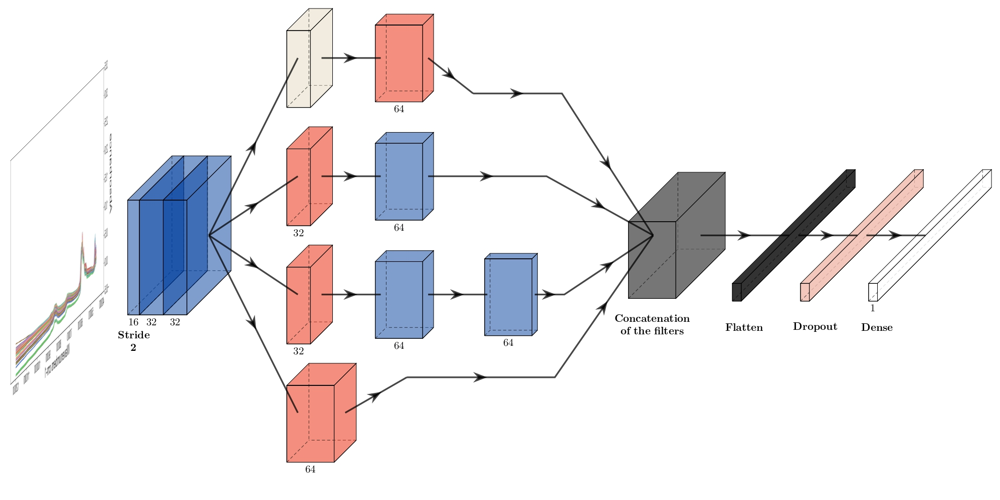
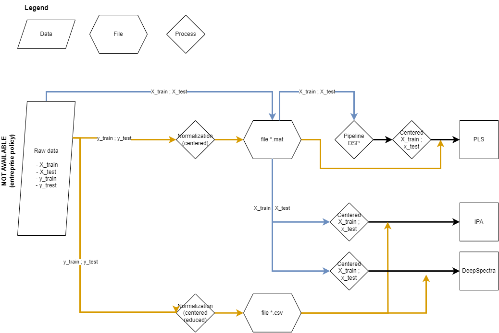

# IPA: Inception for Petroleum Analysis

[](https://github.com/florent-haffner/inception-pretroleum-analysis/actions/workflows/tests.yml)

Code accompanying the paper **"IPA: A deep CNN based on Inception for Petroleum Analysis"**, published in *Fuel* (Elsevier), 2025.
It predicts the cetane number (CN) of middle distillates from near-infrared (NIR) spectra, and compares the IPA deep CNN with PLS and DeepSpectra.

📄 **Paper (open access):** [https://doi.org/10.1016/j.fuel.2024.133016](https://doi.org/10.1016/j.fuel.2024.133016)

## Abstract

> Deep learning is emerging as a challenger to chemometrics which was used for decades to predict properties of petroleum cuts using Near-Infrared spectroscopy (NIR). In this study, a new CNN "Inception for Petroleum Analysis" (IPA) has been developed and its performance compared with both PLS and recent deep learning reference model DeepSpectra to predict CN of middle distillates. IPA, is inspired from state-of the-art computer vision architectures. It is based on several computational blocks with the ambition to meet the daily needs in NIR analysis and is especially suited for small datasets like less than 250 samples. Two datasets were considered, a first one with a reduced spectral range, using variable selection, in which saturated variables have been removed for PLS modeling, and a larger dataset, without variable selection, to evaluate the robustness of IPA. IPA demonstrates regression errors 40% smaller than PLS, and therefore much closer to measured data. Compared with a benchmark Deep Learning model, in particular DeepSpectra, IPA is 20% more accurate. On the same dataset in its full-range of 4150 features, IPA demonstrates a regression error 50% smaller than PLS, and 21% more accurate than DeepSpectra. These results are due to the ability of IPA to both extract complex representation from spectra and not being distracted by parts of the dataset who are considered saturated by experts. This new method improves the performance and reduces the dependence on complex pre-processing operations on dataset, like variable selection and digital signal processing.

*Abstract reproduced from the article, © 2024 The Author(s), published by Elsevier Ltd under the [CC BY 4.0](https://creativecommons.org/licenses/by/4.0/) license.*

## Citation

```bibtex
@article{haffner2025ipa,
  title   = {IPA: A deep CNN based on Inception for Petroleum Analysis},
  author  = {Haffner, F. and Lacoue-Negre, M. and Pirayre, A. and Gon{\c{c}}alves, D. and Gornay, J. and Moreaud, M.},
  journal = {Fuel},
  volume  = {379},
  pages   = {133016},
  year    = {2025},
  doi     = {10.1016/j.fuel.2024.133016}
}
```

## The IPA architecture



Convolutions with kernel size 3 are shown in blue, convolutions with kernel size 1 in red.
The number of neurons is shown under each computational block.
More details are in the paper, section *Methodology / Deep learning*.

## Repository structure

```
├── Makefile        # Every command (install, run, test, Docker)
├── data/           # NIR spectra (.mat) and scaled targets (.csv)
├── docs/images/    # Figures used in this README
├── env/            # requirements, conda environment, Dockerfile
├── matlab/         # PLS / chemometrics functions
├── scripts/        # Calibration entry points (Python script, MATLAB live script)
├── src/            # Architectures (IPA, DeepSpectra) and training pipeline
└── tests/          # pytest suite
```

## Getting started

### MATLAB (PLS)
Install [MATLAB R2022b](https://www.mathworks.com/products/new_products/release2022b.html) and [Eigenvector PLS_Toolbox 9.2](https://wiki.eigenvector.com/index.php?title=Release_Notes_Version_9_2), then open `scripts/Chemometics-calibration.mlx` in MATLAB.

### Python (IPA and DeepSpectra)
The Python environment uses Python 3.13 and TensorFlow 2.21 (Keras 3), the latest stable releases as of November 2026.
Environment files live in `env/` and every command goes through the `Makefile`:

```bash
make help
```

#### Docker (CPU)
Build the image, then run it. Trained weights are written to `./model`:
```bash
make docker-build
```
```bash
make docker-run
```

#### Local virtualenv
Creates `.venv` (with [uv](https://docs.astral.sh/uv/) if installed, otherwise `python3.13 -m venv`) and launches the calibration:
```bash
make run
```

#### Conda
Requires miniconda/anaconda.
```bash
make conda-env
```
```bash
make run-conda
```

#### GPU
On Linux, replace `tensorflow` with `tensorflow[and-cuda]` in `env/requirements.txt` (CUDA 12 and cuDNN 9 are installed by pip).

### Tests
Fast tests use small synthetic data and run in about 20 seconds:
```bash
make test
```
Include short trainings on the real dataset:
```bash
make test-all
```
The suite covers the architectures (output shapes, parameter counts, seeds), the pipeline (loading, preprocessing, save/reload), the model factory, the metrics, the plots and the integrity of `data/`.

## Customising the pipeline
`scripts/models-calibration.py` offers three entry points, selected in `main()`:
- `compare_models()`: train and compare both models,
- `basic_usage()`: the simplest usage,
- `config_from_dict()`: change the configuration from a dictionary.

To add another architecture, extend the classes in `src/model_utils/` (`ModelType`, `BaseModelConfig`, `BaseModelPipeline`) and register it in `ModelFactory` (`_registry` and `_config_registry`), or call `ModelFactory.register_model()`.

## Notes about the data



All targets are already normalised to follow company policy, and the scaler is not provided. Metrics computed here are therefore roughly 10 times smaller than in the paper.
- **PLS** uses X and y from `data/raw-kennard-full_range.mat`: y is centred, X is raw.
- **IPA and DeepSpectra** use y from `data/y_train_scaled.csv` and `data/y_test_scaled.csv` (standardised with the training set: mean 0, std 1). X is raw, either full range (`data/raw-kennard-full_range.mat`, 4150 features) or after variable selection (`data/raw-kennard-reduced_range.mat`, 3890 features).
- Train/test split: Kennard-Stone, 174 training and 75 test samples.
